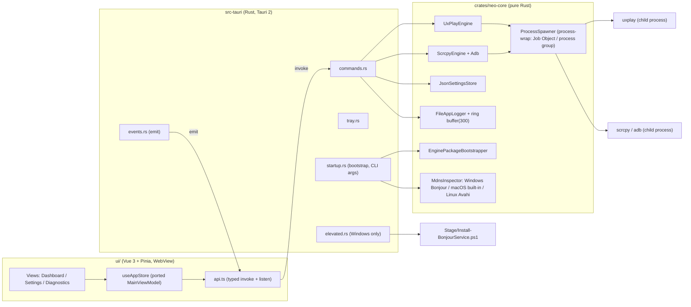
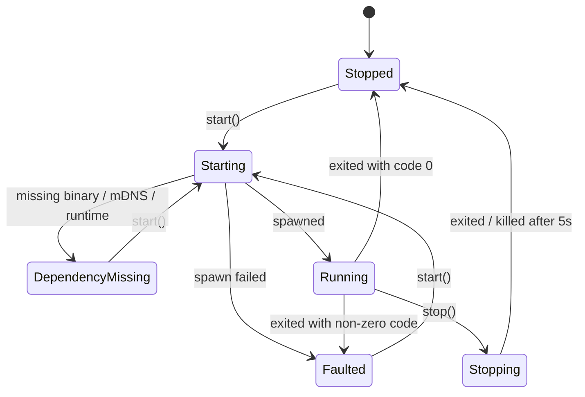
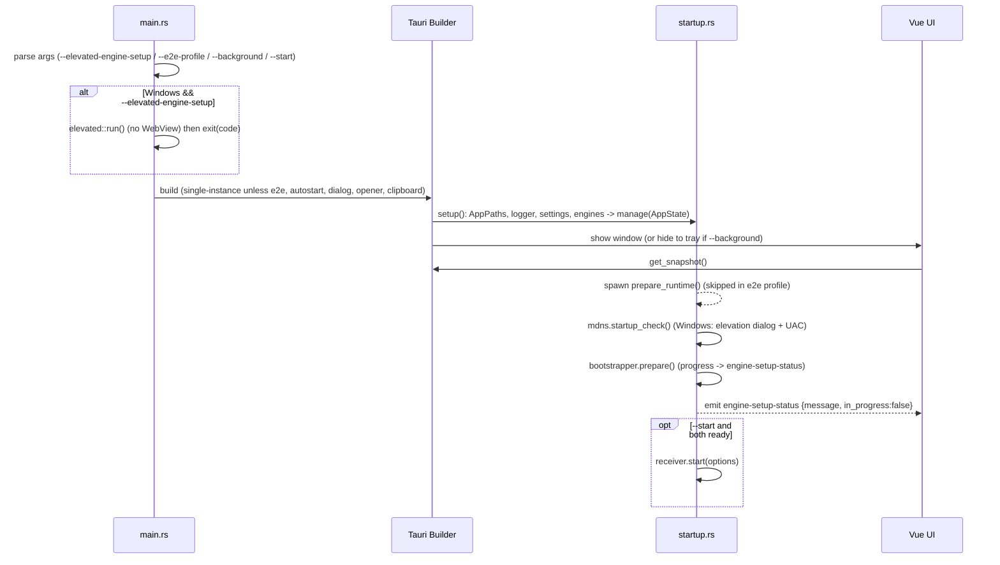
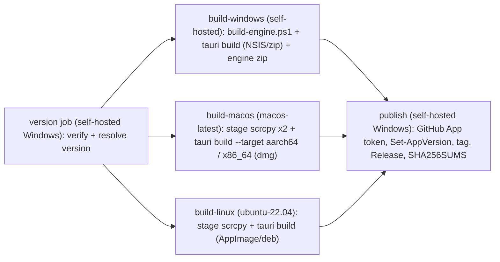

# Neo AirPlay 跨平台遷移設計規格書：Tauri 2 + Rust + TypeScript + Vite + Vue 3（Bun）

> 撰寫日期：2026-10-07 ・ 目前分支：`feature/cross-platform`（與 `develop` 同為 `9f77c9e`）
> 依據：目前工作樹程式碼、[README.md](file:///Users/ben/projects/neo-airplay/README.md)、[ARCHITECTURE.md](file:///Users/ben/projects/neo-airplay/.neo_harness/ARCHITECTURE.md)、[SECURITY.md](file:///Users/ben/projects/neo-airplay/.neo_harness/SECURITY.md)、[RELIABILITY.md](file:///Users/ben/projects/neo-airplay/.neo_harness/RELIABILITY.md)，以及 2026-10-07 查詢的 npm、crates.io 與 GitHub Releases 版本資料。

---

## 1. 目標與背景

### 1.1 目標

1. 把 Windows 限定的 WPF/.NET 10 App（`NeoAirPlay.App` 和 `NeoAirPlay.Framework`）改寫成 **Tauri 2 桌面應用**：後端用 **Rust**，前端用 **Vue 3 + TypeScript + Vite**，前端套件由 **Bun** 管理。
2. 支援 **Windows x64、macOS（Apple Silicon 與 Intel）、Linux x64**。
3. 保留所有現有使用者功能和 Harness 規範：AirPlay（UxPlay）與 Android（scrcpy）可同時投影、系統匣、登入後自動啟動、診斷記錄、首次啟動補齊引擎、Windows Bonjour 受保護安裝、`--background` / `--start` / `--e2e-profile`。
4. 兩版並行開發。功能對齊並驗證後，最後一個階段才移除 .NET 專案。

### 1.2 已確認的決策

| 項目 | 決策 |
| :--- | :--- |
| 平台 | Windows x64、macOS arm64 與 x64、Linux x64 |
| 引擎策略 | 混合模式：scrcpy/adb 三平台都隨附官方版本；UxPlay 在 Windows 照現在隨附，macOS/Linux 使用系統上的 UxPlay，App 提供安裝指引（macOS 的修正見 §2 Q1） |
| 遷移方式 | 同分支並行開發，最後一個階段移除 .NET |
| 簽章 | 先發佈未簽章版本；CI 保留簽章與公證步驟，預設不啟用 |

### 1.3 目標版本（2026-10-07 查得的最新穩定版）

| 元件 | 版本 | 備註 |
| :--- | :--- | :--- |
| Rust toolchain | **1.99.0** | 以 `rust-toolchain.toml` 固定；Tauri MSRV 1.90。本機目前是 1.96，需要升級 |
| tauri / tauri-build | **2.12.1** / **2.7.1** | 不用 v3（目前仍是 3.0.0-alpha.4） |
| @tauri-apps/cli / api | **2.12.1** | |
| Tauri plugins | single-instance 2.5.2、autostart 2.7.0、opener 2.7.0、dialog 2.x、clipboard-manager 2.x、log 2.10.0 | dialog 與 clipboard-manager 的確切版本在階段 0 鎖定 |
| Bun | **1.4.2** | 以 `packageManager` 欄位固定；本機目前是 1.3.5，需要升級 |
| Vite | **8.3.3** | 預設 bundler 為 Rolldown；需要 Node `^20.19 \|\| >=22.12` |
| Vue | **3.5.43** | 3.6（Vapor）仍是 RC，不採用 |
| TypeScript | **7.0.2**（第一選擇）/ 6.0.x（備案） | 見 §2 Q3 |
| vue-tsc | 3.3.12 | |
| @vitejs/plugin-vue | 6.0.9 | |
| vue-router | 5.3.1 | |
| pinia | 4.0.3 | 必須另外安裝 `@vue/devtools-api ^8.1.5` |
| Vitest | 5.0.3 | 需要 Node 22.12+；本機 Node 22.18 符合 |
| scrcpy | **5.0**（提議從 4.1 升級） | 見 §2 Q2 |
| UxPlay | 1.73.7（維持） | 1.74 仍是實驗版 |

> [!NOTE]
> Vite 8 與 Vitest 5 都以 Node 執行。Bun 負責套件管理和 script 執行（`bun install`、`bun run …`）。開發機和 CI 仍需要 Node 22.12 以上。

---

## 2. User Review Required 與 Open Questions

> [!IMPORTANT]
> **Q1：macOS 的 UxPlay 來源需要修正。** 研究結果顯示 UxPlay **沒有 Homebrew formula，也沒有任何官方預建二進位檔**。Linux 各發行版有套件（Fedora 43/44 為 1.73.7、Ubuntu 26.04 為 1.73.2、Debian unstable、AUR）。macOS 可行的做法：
> - **(建議) A**：App 先偵測現有的 `uxplay`，依序找設定中的自訂路徑、`/opt/homebrew/bin`、`/usr/local/bin`、`~/Library/Application Support/NeoAirPlay/engine/uxplay/`。找不到時，App 提供一行可複製的指令執行 `scripts/install-uxplay-macos.sh`。這支腳本用 Homebrew 安裝 GStreamer、libplist、openssl@3，下載並核對固定版本 v1.73.7 原始碼的 SHA-256，在本機編譯後安裝到使用者資料夾。App 不會自動執行 brew。
> - B：CI 編譯 uxplay 並隨附，但要求使用者自行 `brew install` 依賴。dylib 路徑綁定 Homebrew prefix，arm64 和 Intel 的 prefix 也不同，容易出錯。
> - C：連同 GStreamer.framework 完整隨附。套件大、建置成本高，這就是你先前否決的做法。

> [!IMPORTANT]
> **Q2：是否將 scrcpy 從 v4.1 升級到 v5.0？** 新平台本來就要重新 staging，v5.0 提供 win64、macos-aarch64、macos-x86_64、linux-x86_64 官方包與 `SHA256SUMS.txt`。v5.0 預設啟用硬體解碼（`--hwdec=auto`），規格中加入 `--hwdec=disabled` 的設定作為後備。**建議升級。**

> [!WARNING]
> **Q3：TypeScript 7 與 vue-tsc 的相容性尚未確認。** TS 7 是 Go 原生編譯器，有報告指出 Volar/vue-tsc 依賴的 programmatic API 還不完整（UNVERIFIED）。做法：階段 0 先用 TS 7.0.2 跑 `vue-tsc --noEmit`。失敗就改用 `typescript ~6.0`，並記錄在執行計畫的「決策」段落。

> [!WARNING]
> **行為變更 1：取消「引擎安裝需要 UAC」流程。** 目前引擎缺件時會安裝到 App 目錄，目錄不可寫就以 UAC 啟動 helper。在 macOS 寫入 `.app` 會破壞簽章，所以新版**一律把下載的引擎安裝到使用者資料夾**（Windows 為 `%LocalAppData%\NeoAirPlay\engine`）。查找順序是隨附資源優先，其次是使用者資料夾。UAC 只保留給 Bonjour Service。信任程度與目前解壓縮到使用者目錄的可攜 ZIP 相同，下載時的 SHA-256 與逐檔驗證完全保留。

> [!WARNING]
> **行為變更 2：重複啟動的處理。** 目前會跳出「已經在系統匣中執行」訊息框。新版改用 `tauri-plugin-single-instance`，直接把既有視窗叫回前景。E2E profile 不註冊這個 plugin。

> [!WARNING]
> **行為變更 3：CI 必要檢查。** CI 會改成三平台 matrix，並加上一個彙總 job，名稱維持 `verify`，讓 `main` 的分支規則不必修改。Release 的 Windows 部分仍需要自架 runner（UxPlay 的 Windows 建置需要本機 Bonjour 的 x64 `dnssd.dll`）。macOS 與 Linux 使用 GitHub-hosted runner。

> [!NOTE]
> **Q4：Windows 發佈格式。** 建議提供 **NSIS 每使用者安裝程式（不需管理員）+ 可攜 ZIP**，保留目前「解壓縮即可執行」的體驗。Linux 建議提供 **AppImage + .deb**，macOS 提供 **.dmg**（未簽章，首次開啟需右鍵開啟）。

> [!NOTE]
> 工作目錄裡有先前嘗試留下的未追蹤殘留物：空的 `src-tauri/` 與 `ui/`、`node_modules/`、`dist/`，以及 `.build/tauri-uxplay-{macos,linux}`、`.build/tauri-scrcpy`。階段 0 會刪除前四者並重新產生。`.build/` 已被 gitignore，保留不動，但新流程不依賴其中內容。

---

## 3. 目標架構

### 3.1 對應關係（現況 → 新版）

| 現況 (.NET) | 新版 | 說明 |
| :--- | :--- | :--- |
| `NeoAirPlay.Framework`（模型與服務，不參考 WPF） | `crates/neo-core`（純 Rust library，不依賴 Tauri） | 維持「服務與 UI 分離」，可用 `cargo test` 獨立測試 |
| `NeoAirPlay.App`（WPF 組裝、ViewModel、系統匣、UAC helper） | `src-tauri`（Tauri glue：commands、events、tray、autostart、elevated helper） | |
| XAML Views + `MainViewModel` | `ui/`（Vue 3 SFC + Pinia store） | ViewModel 的狀態與命令條件移入 `useAppStore` |
| `IReceiverEngine` 等介面 | Rust traits（`ReceiverEngine`、`AndroidMirrorEngine`、`SettingsStore`、`AppLogger`、`ProcessSpawner`、`MdnsInspector`） | 單元測試以替身注入 |
| xUnit Unit / E2E / HardwareE2E | `cargo test` / Vitest / WebdriverIO + `@wdio/tauri-service` / `cargo test -- --ignored` | |
| `verify.ps1`（Windows PowerShell + dotnet） | `verify.ps1`（PowerShell 7 跨平台） | 入口路徑不變，符合 AGENTS.md |

### 3.2 元件圖



### 3.3 目錄配置

```text
neo-airplay/
├─ package.json  bun.lock  tsconfig.json  tsconfig.node.json  vite.config.ts
├─ ui/                         # 前端（不放在 src/，避免和並行期間的 .NET src/ 衝突）
│  ├─ index.html
│  └─ src/{main.ts, App.vue, router.ts, api/, bindings/, stores/, views/, components/, styles/}
│     └─ __tests__/            # Vitest
├─ Cargo.toml  Cargo.lock  rust-toolchain.toml   # Cargo workspace
├─ crates/neo-core/
│  ├─ src/{lib.rs, models.rs, paths.rs, settings.rs, logger.rs, platform.rs,
│  │       process/{mod.rs, windows.rs, unix.rs},
│  │       engines/{uxplay.rs, scrcpy.rs, adb.rs, locate.rs},
│  │       mdns/{mod.rs, windows_bonjour.rs, macos.rs, linux_avahi.rs},
│  │       package/{settings.rs, manifest.rs, archive.rs, bootstrapper.rs}}
│  └─ tests/{fixtures/, hardware.rs}
├─ src-tauri/
│  ├─ Cargo.toml  build.rs  tauri.conf.json  tauri.{windows,macos,linux}.conf.json
│  ├─ capabilities/default.json  icons/
│  └─ src/{main.rs, lib.rs, state.rs, commands.rs, events.rs, tray.rs, startup.rs, dialogs.rs, elevated.rs}
├─ e2e/{wdio.conf.ts, specs/navigation.e2e.ts, specs/android-hardware.e2e.ts}
├─ engine/                     # gitignored；建置與 staging 的輸出位置
├─ scripts/                    # 保留現有 Windows ps1，新增跨平台腳本（§4.9）
└─ src/, tests/, NeoAirPlay.slnx   # .NET，於階段 9 刪除
```

---

## 4. 詳細設計

### 4.1 工具鏈與工作區設定

#### [NEW] rust-toolchain.toml
```toml
[toolchain]
channel = "1.99.0"
components = ["rustfmt", "clippy"]
targets = ["x86_64-pc-windows-msvc", "aarch64-apple-darwin", "x86_64-apple-darwin", "x86_64-unknown-linux-gnu"]
```

#### [NEW] Cargo.toml（workspace）
```toml
[workspace]
resolver = "3"
members = ["crates/neo-core", "src-tauri"]

[workspace.package]
version = "0.1.0"          # 由 Set-AppVersion.ps1 同步
edition = "2024"
rust-version = "1.90"
license = "UNLICENSED"

[workspace.dependencies]
tokio = { version = "1", features = ["rt-multi-thread", "macros", "process", "sync", "time", "fs", "io-util"] }
serde = { version = "1", features = ["derive"] }
serde_json = "1"
thiserror = "2"
process-wrap = { version = "10", features = ["tokio1", "job-object", "kill-on-drop", "process-group", "creation-flags"] }
reqwest = { version = "0.12", default-features = false, features = ["rustls-tls", "stream"] }
sha2 = "0.11"
zip = "8"
dirs = "7"
ts-rs = "*"               # 階段 0 鎖定確切版本
```

#### [NEW] package.json
```jsonc
{
  "name": "neo-airplay",
  "private": true,
  "version": "0.1.0",                       // 版本單一來源；tauri.conf.json 指向此檔
  "type": "module",
  "packageManager": "bun@1.4.2",
  "engines": { "node": ">=22.12" },
  "scripts": {
    "dev": "vite",
    "build": "vite build",
    "typecheck": "vue-tsc --noEmit -p tsconfig.json",
    "test": "vitest run",
    "tauri": "tauri",
    "e2e": "wdio run e2e/wdio.conf.ts"
  },
  "dependencies": {
    "vue": "3.5.43", "vue-router": "5.3.1", "pinia": "4.0.3", "@vue/devtools-api": "^8.1.5",
    "@tauri-apps/api": "2.12.1",
    "@tauri-apps/plugin-dialog": "^2", "@tauri-apps/plugin-clipboard-manager": "^2"
  },
  "devDependencies": {
    "@tauri-apps/cli": "2.12.1", "vite": "8.3.3", "@vitejs/plugin-vue": "6.0.9",
    "typescript": "7.0.2", "vue-tsc": "3.3.12", "vitest": "5.0.3",
    "@vue/test-utils": "^2", "happy-dom": "*",
    "@wdio/cli": "*", "@wdio/tauri-service": "*"
  }
}
```

#### [NEW] vite.config.ts
```ts
import { defineConfig } from 'vite'
import vue from '@vitejs/plugin-vue'

export default defineConfig({
  root: 'ui',
  plugins: [vue()],
  clearScreen: false,
  server: { port: 1420, strictPort: true },
  envPrefix: ['VITE_', 'TAURI_ENV_'],
  build: { outDir: '../dist', emptyOutDir: true, target: 'es2022' },
  test: { environment: 'happy-dom', include: ['src/**/__tests__/**/*.test.ts'] },
})
```

#### [MODIFY] .gitignore
新增 `node_modules/`、`/target/`、`.vitest/`、`src-tauri/gen/`。`dist/` 與 `/engine/` 已在清單內。

---

### 4.2 Rust 核心 `crates/neo-core`

#### 4.2.1 模型（對應 `ReceiverSettings.cs`、`AndroidDevice.cs`）

```rust
#[derive(Clone, Debug, PartialEq, Eq, Serialize, Deserialize, TS)]
#[serde(rename_all = "PascalCase")]          // 與既有 settings.json 相容（System.Text.Json 預設 PascalCase）
pub struct ReceiverSettings {
    #[serde(default = "default_name", alias = "receiverName")] pub receiver_name: String,
    #[serde(default = "auto",        alias = "renderer")]     pub renderer: String,
    #[serde(default,                 alias = "fullscreen")]   pub fullscreen: bool,
    #[serde(default,                 alias = "startOnLogin")] pub start_on_login: bool,
    #[serde(default,                 alias = "androidHwDecode")] pub android_hw_decode: bool, // 新增，對應 scrcpy --hwdec
    #[serde(default)]                                         pub uxplay_path: Option<String>, // 新增：macOS/Linux 自訂路徑
}

#[derive(Clone, Copy, Debug, PartialEq, Eq, Serialize, TS)]
pub enum ReceiverState { Stopped, Starting, Running, Stopping, Faulted, DependencyMissing }

#[derive(Clone, Debug, Serialize, TS)]
pub struct EngineStatus { pub state: ReceiverState, pub message: String }

#[derive(Clone, Debug, Serialize, TS)]
pub struct AndroidDevice { pub serial: String, pub model: String, pub status: AndroidDeviceStatus }
```

**Renderer 依平台處理**（`platform.rs`）。設定檔儲存抽象值，`sanitize()` 會把目前平台不支援的值改回 `Auto`：

| 平台 | 選項 → `-vs` 參數 |
| :--- | :--- |
| Windows | `Auto`、`D3D11` → `d3d11videosink`、`D3D12` → `d3d12videosink`（與現況相同） |
| macOS | `Auto`、`GL` → `glimagesink`、`OSX` → `osxvideosink` |
| Linux | `Auto`、`GL` → `glimagesink`、`Xv` → `xvimagesink`、`Wayland` → `waylandsink` |

#### 4.2.2 使用者資料路徑（`paths.rs`）

為了與既有 Windows 使用者相容，**不使用** Tauri `app_config_dir()`（它會套用 bundle identifier）。改用 `dirs` 明確組合路徑：

| 用途 | Windows（不變） | macOS | Linux |
| :--- | :--- | :--- | :--- |
| 設定 | `%AppData%\NeoAirPlay\settings.json` | `~/Library/Application Support/NeoAirPlay/settings.json` | `$XDG_CONFIG_HOME/NeoAirPlay/settings.json` |
| 記錄 | `%LocalAppData%\NeoAirPlay\Logs\` | `~/Library/Logs/NeoAirPlay/` | `$XDG_STATE_HOME/NeoAirPlay/logs/` |
| GStreamer 快取 | `%LocalAppData%\NeoAirPlay\gstreamer-registry.bin` | 不設定（使用系統 GStreamer） | 不設定 |
| 下載的引擎 | `%LocalAppData%\NeoAirPlay\engine\` | `~/Library/Application Support/NeoAirPlay/engine/` | `$XDG_DATA_HOME/NeoAirPlay/engine/` |
| 套件快取 | `%LocalAppData%\NeoAirPlay\EnginePackages\` | `~/Library/Caches/NeoAirPlay/EnginePackages/` | `$XDG_CACHE_HOME/NeoAirPlay/EnginePackages/` |

`--e2e-profile <path>` 和現在一樣，會把以上所有路徑導向測試 profile（對應 [AppDataPaths.cs](file:///Users/ben/projects/neo-airplay/src/NeoAirPlay.App/AppDataPaths.cs)）。

#### 4.2.3 記錄（對應 `FileAppLogger.cs`）
- 檔名 `yyyy-MM-dd.log`。行格式維持 `[yyyy-MM-dd HH:mm:ss.fff zzz] [Information|Warning|Error] message`，換行字元換成空白。
- 新增一個容量 300 筆的記憶體環形緩衝區。WebView 重新載入後可以透過 `get_snapshot` 取回最近記錄（WPF 版沒有這個需求）。
- 透過 `tokio::sync::broadcast` 發佈 `AppLogEntry`，由 `src-tauri` 轉成 `log-entry` 事件。寫檔失敗仍會廣播，與現況相同。

#### 4.2.4 程序管理（取代 `ReceiverProcess.cs`、`AndroidCommandRunner.cs`）

```rust
#[async_trait]
pub trait ProcessSpawner: Send + Sync {
    async fn spawn(&self, spec: ProcessSpec) -> io::Result<Box<dyn ChildHandle>>;
    async fn run_to_end(&self, spec: ProcessSpec, timeout: Duration) -> io::Result<CommandOutput>; // adb devices -l，15 秒逾時
}
pub struct ProcessSpec { pub program: PathBuf, pub args: Vec<OsString>, pub cwd: PathBuf, pub env: Vec<(OsString, OsString)> }
```

- 參數一律逐項傳入 `args`，**不經 shell**。這延續 SECURITY.md 的 `ArgumentList` 要求，裝置序號仍是獨立引數。
- **Windows**：`process-wrap` 的 `JobObject` + `KillOnDrop` + `CREATE_NO_WINDOW`。停止流程：用 `EnumWindows` 找出該 PID 的頂層視窗並 `PostMessage(WM_CLOSE)`，等同 `CloseMainWindow`；最多等 5 秒，逾時就終止 Job Object（整個程序樹）。
- **macOS/Linux**：`ProcessGroup` + `KillOnDrop`。停止流程：對程序群組送 `SIGTERM`，最多等 5 秒，逾時送 `SIGKILL`。
- stdout/stderr 逐行讀取：stdout 記為 Information，stderr 記為 Warning，前綴 `UxPlay:` / `scrcpy:`，與現況相同。
- **可靠性改進**：App 當掉時，Job Object 或 kill-on-drop 會連帶結束子程序。WPF 版沒有這層保護。

#### 4.2.5 引擎狀態機（UxPlay 和 scrcpy 共用規則，對應 RELIABILITY.md）



- 每個引擎各有一個 `tokio::sync::Mutex` 作為生命週期鎖，兩個引擎互不影響。已在執行時重複呼叫 `start()` 直接返回。
- 狀態以 `tokio::sync::watch::Sender<EngineStatus>` 發佈，`src-tauri` 轉送為 `receiver-status` / `android-status` 事件。
- 退出監看 task 會比對 `generation` 序號與 `stop_requested` 旗標，避免舊程序的退出事件覆寫新狀態。這對應 C# 的 `ReferenceEquals(_process, process)`。
- Android：ADB 刷新失敗但投影仍在執行時，狀態維持 `Running`（沿用現行規則）。

#### 4.2.6 UxPlay 引擎（對應 `UxPlayProcessEngine.cs`）

```rust
pub fn uxplay_args(opts: &ReceiverOptions, platform: Platform) -> Vec<OsString> {
    let mut a = vec!["-n".into(), opts.receiver_name.clone().into(), "-nh".into()];
    if opts.fullscreen { a.push("-fs".into()); }
    if let Some(sink) = platform.video_sink(&opts.renderer) { a.push("-vs".into()); a.push(sink.into()); }
    a
}
```

| 平台 | 執行檔解析（`engines/locate.rs`） | 環境變數 | 啟動前檢查 |
| :--- | :--- | :--- | :--- |
| Windows | 隨附資源 `engine/uxplay.exe`，其次 `%LocalAppData%\NeoAirPlay\engine\uxplay.exe` | `PATH` = engine + runtime/bin + Bonjour 目錄 + 原 PATH；`GST_PLUGIN_PATH`、`GST_PLUGIN_SYSTEM_PATH_1_0`、`GST_REGISTRY`、`GST_PLUGIN_SCANNER`（與現況相同） | `runtime/bin`、`runtime/lib/gstreamer-1.0` 存在；Bonjour 狀態正常 |
| macOS | 設定的 `uxplay_path` → `/opt/homebrew/bin/uxplay` → `/usr/local/bin/uxplay` → `<AppData>/engine/uxplay/uxplay` → `PATH` | 不覆寫 GStreamer 變數。PATH 會補上 Homebrew prefix，因為 GUI App 不會繼承 shell 的 PATH | 系統內建 mDNSResponder（固定可用）；顯示「關閉 macOS 隔空播放接收器」提示（避免 port 7000 衝突） |
| Linux | 設定的 `uxplay_path` → `PATH`（`/usr/bin/uxplay` 等） → `<XDG_DATA>/engine/uxplay/uxplay` | 不覆寫 | `avahi-daemon` 正在執行（`systemctl is-active avahi-daemon`，失敗時改查 D-Bus `org.freedesktop.Avahi`） |

- 版本檢查：執行 `uxplay -h` 解析第一行的版本號，最低要求 **1.68**（Ubuntu 24.04 套件版本）。低於門檻時只顯示警告，不阻擋啟動。輸出格式在階段 2 實測確認，目前標為 UNVERIFIED。
- 缺件時狀態設為 `DependencyMissing`，訊息依平台提供安裝指引（§4.6）。

#### 4.2.7 scrcpy 與 ADB（對應 `ScrcpyAndroidMirrorEngine.cs`）
- `parse_adb_devices()` 逐字移植：略過 `List` 與 `*` 開頭的行；`device`/`unauthorized`/`offline` 以外的狀態歸為 Unknown；`model:` 欄位裡的 `_` 換成空白。
- scrcpy 參數：`--serial <s> --window-title "Neo AirPlay - Android (<s>)" [--fullscreen] [--hwdec=disabled]`。
- 必要檔案清單改為各平台一份：`scripts/scrcpy-runtime-files.{windows-x86_64,macos-aarch64,macos-x86_64,linux-x86_64}.txt`。編譯時以 `include_str!` 嵌入，維持「唯一清單」原則，staging 腳本讀取同一份檔案。
- macOS/Linux 的 tarball 若不含 `adb`（v5.0 是否包含尚未確認），staging 腳本改從 Google 官方 platform-tools 37.0.1 下載，並鎖定 SHA-256。
- Linux：裝置顯示 `no permissions` 時，提示安裝 Android udev rules。

#### 4.2.8 mDNS 檢查（`mdns/`，取代 `BonjourServiceInspector.cs` 與 `BonjourStartupCoordinator.cs`）

```rust
pub trait MdnsInspector: Send + Sync {
    fn runtime(&self) -> Result<MdnsRuntime, MdnsProblem>;       // 引擎啟動前檢查
    fn startup_check(&self) -> StartupCheck;                      // App 啟動時：Ready | NeedsElevatedRepair{reason} | Missing{problem, help_url}
}
```

- **Windows（`windows_bonjour.rs`）**：逐條移植 573 行 C# 邏輯。
  - 用 `windows-service` 0.8 查詢 Bonjour Service 的狀態與 ImagePath。
  - 用 `windows` 0.62 的 `GetFileVersionInfoW` / `VerQueryValueW` 讀取產品名稱與 FileVersion。
  - 用 `object` 0.40 讀取 PE Machine 欄位，限定 x64。
  - 候選路徑與訊息仍讀取共用的 [BonjourServiceSettings.json](file:///Users/ben/projects/neo-airplay/scripts/BonjourServiceSettings.json)（`include_str!`），PowerShell 腳本繼續使用同一份檔案。
  - 規則全部保留：不接受 SysWOW64 的 x86 DLL、responder 與 DLL 版本必須相同、只從受信任的 Program Files 或 System32 取檔。
- **macOS（`macos.rs`）**：mDNSResponder 是系統元件，固定回傳 Ready。
- **Linux（`linux_avahi.rs`）**：avahi-daemon 未執行時回傳 `Missing`，附上 `sudo systemctl enable --now avahi-daemon` 指引。App 不自動提權。

#### 4.2.9 引擎套件準備器（對應 `EnginePackageBootstrapper.cs`）

**[MODIFY] engine-package.json → schema v2**（移到 `src-tauri/engine-package.json`，以資源形式隨附）：
```jsonc
{
  "SchemaVersion": 2,
  "Version": "0.1.0",
  "ReleaseTag": "v0.1.0",
  "ManifestName": "engine-package-manifest.json",
  "Targets": {
    "windows-x86_64": { "AssetName": "neo-airplay-engine-windows-x86_64.zip", "Sha256": "<64 hex>",
                        "AirPlayFiles": ["engine/uxplay.exe", "..."], "AndroidFiles": ["engine/android/scrcpy.exe", "..."], "SharedFiles": [] },
    "macos-aarch64":  { "AssetName": "neo-airplay-engine-macos-aarch64.zip", "Sha256": "...", "AirPlayFiles": [], "AndroidFiles": ["..."], "SharedFiles": [] },
    "macos-x86_64":   { "...": "..." },
    "linux-x86_64":   { "...": "..." }
  }
}
```
- macOS/Linux 的 `AirPlayFiles` 是空陣列，因為 UxPlay 來自系統。驗證規則相應放寬：至少一個群組非空即可。
- 安全檢查全部保留，並各有單元測試：
  - 版本正規式、`ReleaseTag == v{Version}`、資產名稱白名單
  - 外層 SHA-256、1.5 GB 下載與解壓上限
  - ZIP entry 拒絕：絕對路徑、`\`、`:`、`.`、`..`、空路徑段、symlink（unix mode `0xA000`）、重複項目、`engine/bonjour/` 前綴
  - manifest 與 App 設定清單集合相同、逐檔長度與 SHA-256 相符、ZIP 實際內容與 manifest 集合相同
  - 先放入暫存檔再原子 rename，staging 目錄用完一定清除
- **新增**：Unix 解壓時依 ZIP 內的 unix mode 套用可執行權限（`0o755`），其他檔案為 `0o644`。
- 安裝位置：使用者資料夾的 `engine/`（行為變更 1）。不需要寫入 App 目錄，`RequiresElevation` 路徑整個移除。
- 下載使用 Rust `reqwest`（rustls），**不開放** `tauri-plugin-http` 給前端。

#### 4.2.10 設定儲存（對應 `JsonSettingsStore.cs`）
- 讀取失敗時記一筆 Warning 並回傳預設值。寫入時先寫 `.tmp` 再 rename。`sanitize()`：名稱 trim，空白則用 `Neo AirPlay`；renderer 依平台白名單過濾。
- 對應 C# 測試：讀到 PascalCase 舊檔、壞掉的 JSON、未知 renderer。

---

### 4.3 Tauri 殼層 `src-tauri`

#### 4.3.1 啟動流程（對應 `App.xaml.cs`）



#### [NEW] src-tauri/src/main.rs（重點）
```rust
#![cfg_attr(not(debug_assertions), windows_subsystem = "windows")]
fn main() {
    let args = neo_airplay_lib::cli::CliArgs::parse(std::env::args_os());
    #[cfg(windows)]
    if args.elevated_engine_setup {
        std::process::exit(neo_airplay_lib::elevated::run(&args)); // 不建立 WebView
    }
    neo_airplay_lib::run(args);
}
```

#### 4.3.2 Windows elevated helper（`elevated.rs`，只在 Windows 編譯）
- 主程序以 `ShellExecuteExW(lpVerb = "runas")` 重新啟動自己，參數為 `--elevated-engine-setup --enable-bonjour`。等待結束碼；`ERROR_CANCELLED (1223)` 代表使用者取消 UAC。
- helper 先確認自身以系統管理員執行（`CheckTokenMembership`），再以 `System32\WindowsPowerShell\v1.0\powershell.exe -NoLogo -NoProfile -NonInteractive -ExecutionPolicy Bypass -File` 依序執行資源目錄裡的 `Stage-BonjourRuntime.ps1` 與 `Install-BonjourService.ps1`，stdout/stderr 寫入記錄。這和現況一致，**Bonjour 的 PowerShell 腳本不改寫**。
- `--engine-package-archive` 參數隨行為變更 1 移除。

#### 4.3.3 IPC 介面
前端只透過以下 commands 操作。TS 型別由 `ts-rs` 從 Rust 產生到 `ui/src/bindings/`，verify 會檢查產生結果是否與 repo 一致。

| Command | 參數 → 回傳 | 對應 ViewModel 成員 |
| :--- | :--- | :--- |
| `get_snapshot` | () → `AppSnapshot { receiver, android, devices, settings, platform, logs, engineSetup, version }` | 建構子初始狀態 |
| `start_receiver` / `stop_receiver` | () → `EngineStatus` | `StartCommand` / `StopCommand` |
| `save_settings` | `ReceiverSettings` → `SaveResult { settings, applyPending, message }` | `SaveSettingsCommand`（含 autostart 失敗時回滾） |
| `apply_settings` | () → `EngineStatus` | `ApplySettingsCommand` |
| `refresh_android_devices` | () → `AndroidDevice[]` | `RefreshAndroidDevicesCommand` |
| `start_android_mirror` / `stop_android_mirror` | `serial` / () → `EngineStatus` | Android 命令 |
| `open_log_directory` | () → () | `OpenLogsCommand`（Rust 端呼叫 opener） |
| `hide_to_tray` / `exit_app` | () → () | `MinimizeCommand` / `ExitCommand` |

| Event | Payload |
| :--- | :--- |
| `receiver-status` / `android-status` | `EngineStatus` |
| `log-entry` | `AppLogEntry` |
| `engine-setup-status` | `{ message: string, inProgress: boolean }` |

#### 4.3.4 安全設定（Capabilities / CSP）
- 用 `tauri_build::Builder::new().app_manifest(AppManifest::new().commands(&[...]))` 為自訂 commands 產生權限，`capabilities/default.json` 只授予 `core:default`、上表 commands、`dialog:allow-ask`/`allow-message`、`clipboard-manager:allow-write-text`。
- **不載入 `tauri-plugin-shell`**。前端完全無法啟動程序，所有子程序都由 Rust 依固定路徑啟動。
- opener 只在 Rust 端使用，目標限定記錄資料夾與 `https://support.apple.com/zh-tw/106380`。
- CSP：`default-src 'self'; img-src 'self' data:; style-src 'self'; connect-src ipc: http://ipc.localhost`。

#### 4.3.5 系統匣、關閉行為、自動啟動、單一執行個體
- **Tray**（`tauri` 的 `tray-icon` feature）：選單項目為「開啟 Neo AirPlay」、「啟動接收器」、「停止接收器」、「結束」，與 [MainWindow.xaml.cs](file:///Users/ben/projects/neo-airplay/src/NeoAirPlay.App/MainWindow.xaml.cs) 相同；雙擊開啟視窗。Linux 需要 `libayatana-appindicator3`，且只支援選單，沒有點擊事件。
- **關閉視窗**：攔截 `WindowEvent::CloseRequested`，呼叫 `prevent_close()` 後隱藏視窗。E2E profile 例外，直接關閉。
- **結束**：在 `RunEvent::ExitRequested` 階段，以 `block_on` 同時停止兩個引擎（總逾時 10 秒），之後才真正退出。
- **自動啟動**：`tauri-plugin-autostart` 帶入 `--background --start`。Windows 用 Run 機碼，macOS 用 LaunchAgent，Linux 用 XDG autostart。首次啟動會**移除舊版 WPF 留下的 `HKCU\…\Run\NeoAirPlay` 值**，避免重複啟動。
- **單一執行個體**：第二個執行個體會叫出既有視窗（行為變更 2）。E2E profile 不註冊。
- 視窗標題為 `Neo AirPlay (X.Y.Z)`。側欄副標依平台顯示 `WINDOWS RECEIVER`、`MACOS RECEIVER` 或 `LINUX RECEIVER`。

#### [NEW] src-tauri/tauri.conf.json（摘要）
```jsonc
{
  "$schema": "https://schema.tauri.app/config/2",
  "productName": "Neo AirPlay",
  "version": "../package.json",
  "identifier": "com.benknightdark.neoairplay",
  "build": {
    "beforeDevCommand": "bun run dev", "devUrl": "http://localhost:1420",
    "beforeBuildCommand": "bun run build", "frontendDist": "../dist"
  },
  "app": {
    "windows": [{ "label": "main", "title": "Neo AirPlay", "width": 1080, "height": 720, "minWidth": 900, "minHeight": 600 }],
    "security": { "csp": "default-src 'self'; img-src 'self' data:; style-src 'self'; connect-src ipc: http://ipc.localhost" }
  },
  "bundle": {
    "active": true,
    "resources": { "engine-package.json": "engine-package.json" },
    "icon": ["icons/32x32.png", "icons/128x128.png", "icons/icon.icns", "icons/icon.ico"]
  }
}
```
平台覆寫檔：
- `tauri.windows.conf.json`：`targets: ["nsis"]`、`nsis.installMode: "currentUser"`；resources 加入 `../engine/**/*` 和 Bonjour 腳本（`scripts/*Bonjour*`、`BonjourServiceSettings.json`）；`webviewInstallMode: downloadBootstrapper`。
- `tauri.macos.conf.json`：`targets: ["dmg", "app"]`，resources 加入 `../engine/android/**/*`，`minimumSystemVersion: "12.0"`。
- `tauri.linux.conf.json`：`targets: ["appimage", "deb"]`，resources 同 macOS，deb 依賴 `libwebkit2gtk-4.1-0, libayatana-appindicator3-1`，建議套件 `uxplay, avahi-daemon`。

> 引擎檔案以 `bundle.resources` 隨附，不使用 sidecar（`externalBin`）。UxPlay 需要 GStreamer DLL，scrcpy 需要 adb、server 和多個 DLL，單一 sidecar 執行檔涵蓋不了這些多檔案依賴。

---

### 4.4 前端 `ui/`（Vue 3 + Pinia）

#### 4.4.1 結構
```text
ui/src/
├─ main.ts               # createApp + pinia + router
├─ App.vue               # 版面：Sidebar + Header + AlertBar + <RouterView>
├─ router.ts             # createWebHashHistory；/, /settings, /diagnostics
├─ api/tauri.ts          # 包裝 invoke/listen（具型別）；測試時以 @tauri-apps/api/mocks 替換
├─ bindings/             # ts-rs 產生（勿手改）
├─ stores/app.ts         # useAppStore：移植 MainViewModel
├─ components/{SidebarNav,StatusPill,AlertBar,AirPlayCard,AndroidCard,SetupSteps}.vue
├─ views/{DashboardView,SettingsView,DiagnosticsView}.vue
└─ styles/{tokens.css, base.css}  # 沿用 WPF 色票：#17A773 / #D78016 / #D34444 / #8A99AD / #2878E5
```
不引入 UI 元件框架。WPF 版的視覺以 CSS 變數重建，維持小 bundle，也不需要放寬 CSP。

#### 4.4.2 Store 移植（節錄）
```ts
export const useAppStore = defineStore('app', () => {
  const receiver = ref<EngineStatus>({ state: 'Stopped', message: '' })
  const android = ref<EngineStatus>({ state: 'Stopped', message: '' })
  const saved = ref<ReceiverSettings>(defaults), draft = reactive({ ...defaults })
  const engineSetup = ref({ message: '', inProgress: false })
  const alert = ref(''), applyPending = ref(false)
  const devices = ref<AndroidDevice[]>([]), selectedSerial = ref<string | null>(null)

  const stoppedLike = (s: ReceiverState) => s === 'Stopped' || s === 'Faulted' || s === 'DependencyMissing'
  const canStart = computed(() => !engineSetup.value.inProgress && stoppedLike(receiver.value.state))
  const canStop = computed(() => ['Starting', 'Running'].includes(receiver.value.state))
  const settingsDirty = computed(() => !shallowEqual(draft, saved.value))
  const canApply = computed(() => applyPending.value && receiver.value.state === 'Running')
  const selectedDevice = computed(() => devices.value.find(d => d.serial === selectedSerial.value))
  const canStartAndroid = computed(() => !engineSetup.value.inProgress
    && selectedDevice.value?.status === 'Ready' && stoppedLike(android.value.state))
  const stateLabel = computed(() => STATE_LABELS[receiver.value.state])   // 「正在啟動」「接收器已啟動」…
  // statusTitle / statusDescription / statusAccent / androidStateLabel… 逐字移植中文字串
  async function startReceiver() { alert.value = ''; receiver.value = await api.startReceiver()
    if (receiver.value.state === 'Running') applyPending.value = false
    if (['Faulted', 'DependencyMissing'].includes(receiver.value.state)) alert.value = receiver.value.message }
  async function refreshDevices() {
    const prev = selectedSerial.value
    devices.value = await api.refreshAndroidDevices()
    selectedSerial.value = devices.value.find(d => d.serial === prev)?.serial
      ?? devices.value.find(d => d.status === 'Ready')?.serial ?? devices.value[0]?.serial ?? null }
  // …saveSettings / applySettings / startAndroid / stopAndroid / event subscriptions / log ring (300)
})
```
- E2E 依賴的元素都加上 `data-testid`，取代 WPF 的 `AutomationId`，例如 `current-page-heading`、`nav-settings`、`android-refresh`、`android-start`。
- 訊息框（Bonjour 說明、缺少 Bonjour 時詢問是否開啟 Apple 支援頁）由 Rust 端以 `tauri-plugin-dialog` 顯示，維持現在由 App 層主導的流程。

#### 4.4.3 平台差異的 UI
- 設定頁的「Windows 啟動」改為「登入後自動啟動」。Renderer 下拉選單依 `snapshot.platform.rendererOptions` 產生。
- macOS/Linux 會多出「UxPlay 執行檔」區塊：顯示偵測到的路徑與版本，提供「選擇檔案」（dialog）與「複製安裝指令」。
- Android 卡片新增「硬體解碼」開關（預設關閉，也就是 `--hwdec=disabled`，維持與 v4.1 相同的穩定行為）。

---

### 4.5 引擎建置與 staging 腳本（`scripts/`）

| 腳本 | 狀態 | 說明 |
| :--- | :--- | :--- |
| `build-engine.ps1` | [MODIFY] | Windows 專用。UxPlay 建置不變，scrcpy 改呼叫新的 `Stage-ScrcpyRuntime.ps1 -Target windows-x86_64` |
| `Stage-ScrcpyRuntime.ps1` | [MODIFY] | 改為 PowerShell 7 跨平台。新增 `-Target`，依 `scripts/scrcpy-release.json`（版本、資產名稱、SHA-256）下載官方包、核對 SHA、展開到 `engine/android/`，並設定 `chmod +x` |
| `scrcpy-release.json` | [NEW] | scrcpy v5.0 四個 target 的資產名稱與 SHA-256，以及缺少 adb 時使用的 platform-tools 鎖定值 |
| `scrcpy-runtime-files.*.txt` | [NEW] / 取代單一檔案 | 各平台必要檔案清單 |
| `Pack-EngineRuntime.ps1` | [MODIFY] | PowerShell 7。新增 `-Target`，產生 `neo-airplay-engine-<target>.zip` 與 manifest，並更新 schema v2 對應的 target 項目 |
| `install-uxplay-macos.sh` | [NEW] | 給使用者執行：`brew install cmake pkgconf libplist openssl@3 gstreamer`，下載 UxPlay v1.73.7 原始碼並核對 SHA-256（與 build-engine.ps1 共用鎖定值），編譯後安裝到 `~/Library/Application Support/NeoAirPlay/engine/uxplay/` |
| `install-uxplay-linux.sh` | [NEW] | 給使用者執行：優先建議發行版套件（apt/dnf/pacman）；版本過舊時提供同樣的原始碼編譯流程 |
| `Set-AppVersion.ps1` | [MODIFY] | PowerShell 7。同步 `package.json`、workspace `Cargo.toml`（再執行 `cargo update -w` 更新 lock）、`engine-package.json`；`tauri.conf.json` 以 `../package.json` 取得版本 |
| `Build-ReleasePackage.ps1` | [MODIFY] | Windows：建置引擎 → `bun tauri build` → 輸出 NSIS 安裝程式與可攜 ZIP（exe + resources）、引擎 ZIP、SHA-256 |
| Bonjour 相關 ps1/psm1/json | 不變 | 繼續由 elevated helper 呼叫，PowerShell 5.1 相容測試保留 |

---

### 4.6 依賴缺失時的使用者指引（新增文案）

| 情況 | 平台 | 狀態訊息與動作 |
| :--- | :--- | :--- |
| 找不到 uxplay | macOS | 「找不到 UxPlay。請在終端機執行下列指令安裝，或在設定中指定執行檔。」並提供複製指令按鈕 |
| 找不到 uxplay | Linux | 依 `/etc/os-release` 顯示 `sudo apt install uxplay`、`sudo dnf install uxplay` 或 AUR 指引 |
| Avahi 未執行 | Linux | `sudo systemctl enable --now avahi-daemon`；說明防火牆需開放 UDP 5353 |
| 隔空播放接收器衝突 | macOS | 首次啟動 AirPlay 時提示到「系統設定 > 一般 > AirDrop 與接力」關閉「隔空播放接收器」 |
| Bonjour | Windows | 與現行流程相同（說明 → UAC → 重新檢查；缺少時提供 Apple 支援頁） |

---

### 4.7 Harness、CI 與 Release

#### [MODIFY] .neo_harness/verify.ps1（PowerShell 7，三平台通用）
```powershell
#Requires -Version 7.4
$ErrorActionPreference = 'Stop'
function Step($name, [scriptblock]$cmd) { Write-Host "==> $name"; & $cmd; if ($LASTEXITCODE) { exit $LASTEXITCODE } }
Step 'bun install'        { bun install --frozen-lockfile }
Step 'typecheck'          { bun run typecheck }
Step 'frontend unit'      { bun run test }
Step 'frontend build'     { bun run build }              # tauri::generate_context! 編譯時需要 dist/
Step 'cargo fmt'          { cargo fmt --all --check }
Step 'cargo clippy'       { cargo clippy --workspace --all-targets --locked -- -D warnings }
Step 'cargo test'         { cargo test --workspace --locked }   # 硬體測試標記 #[ignore]
Step 'ts bindings drift'  { git diff --exit-code -- ui/src/bindings }
if ($IsWindows) {
  Step 'Bonjour PS 5.1 compat' { & "$env:SystemRoot\System32\WindowsPowerShell\v1.0\powershell.exe" -NoProfile -NonInteractive -File tests/scripts/BonjourPowerShellCompatibility.Tests.ps1 -RepositoryRoot $PWD -AppScriptsDirectories (Join-Path $PWD 'scripts') }
  # 並行期間（階段 9 之前）保留：dotnet build NeoAirPlay.slnx; dotnet test --filter Category=Unit
}
Step 'Set-AppVersion smoke' { ./tests/scripts/Set-AppVersion.Tests.ps1 }
```
> [!NOTE]
> 本機 Mac 尚未安裝 `pwsh`，需要先 `brew install --cask powershell` 才能跑 verify。Windows 與 Linux 的結果只能由 CI 驗證，我無法在這台機器上執行。

#### [MODIFY] .github/workflows/ci.yml
```yaml
jobs:
  verify-matrix:
    strategy: { fail-fast: false, matrix: { os: [windows-latest, macos-latest, ubuntu-24.04] } }
    runs-on: ${{ matrix.os }}
    steps:
      - uses: actions/checkout@<pinned sha>
      - uses: oven-sh/setup-bun@<pinned sha>  # bun-version-file: package.json
      - uses: actions/setup-node@<pinned sha> # node-version: 22.x（Vite 8 / Vitest 5）
      - uses: dtolnay/rust-toolchain@<pinned sha>  # 讀 rust-toolchain.toml
      - uses: Swatinem/rust-cache@<pinned sha>
      - if: runner.os == 'Linux'
        run: sudo apt-get update && sudo apt-get install -y libwebkit2gtk-4.1-dev libayatana-appindicator3-dev librsvg2-dev patchelf
      - if: runner.os == 'Windows'                # 並行期間
        uses: actions/setup-dotnet@<pinned sha>
      - shell: pwsh
        run: ./.neo_harness/verify.ps1
  verify:                                         # 維持既有必要檢查名稱
    needs: verify-matrix
    runs-on: ubuntu-latest
    steps: [ { run: echo "all platforms passed" } ]
```

#### [MODIFY] .github/workflows/release.yml

- macOS 兩種架構都在 arm64 runner 上以 `--target` 交叉編譯。scrcpy 直接下載各架構的官方包，不需要本機編譯。
- Linux 在 ubuntu-22.04 上建置，以取得較舊 glibc 的相容性（AppImage 慣例）。
- 版本的讀寫改用 `package.json`（目前讀的是 csproj），`paths-ignore` 同步改成 `package.json`、`Cargo.toml`、`Cargo.lock`、`src-tauri/engine-package.json`。
- 簽章：保留 `APPLE_CERTIFICATE`、`APPLE_ID`、`APPLE_TEAM_ID`、`WINDOWS_CERTIFICATE` 的步驟，以 `if: vars.ENABLE_SIGNING == 'true'` 控制，預設不執行。
- `promote-develop.yml` 不需修改。

#### 測試移植對照

| 現有測試 | 新位置 |
| :--- | :--- |
| `JsonSettingsStoreTests`、`FileAppLoggerTests` | `neo-core` 單元測試（`tempfile`） |
| `UxPlayProcessEngineTests`、`ScrcpyAndroidMirrorEngineTests` | `neo-core` 單元測試（`FakeSpawner`，含參數、環境變數、狀態轉移、退出碼、ADB 解析） |
| `BonjourRuntimeSettingsTests`、`BonjourStartupCoordinatorTests` | `neo-core::mdns` 單元測試（`#[cfg(windows)]` 加上與平台無關的規則測試） |
| `EnginePackageBootstrapperTests` | `neo-core::package` 單元測試（以程式產生惡意 ZIP fixture） |
| `MainViewModelTests` | Vitest `stores/__tests__/app.test.ts`（`mockIPC`） |
| `AppEndToEndTests`（UI E2E） | `e2e/specs/navigation.e2e.ts`（WebdriverIO + `@wdio/tauri-service` embedded provider，Win/macOS/Linux 都可執行，需要 `e2e` cargo feature） |
| `ReceiverEnginesHardwareEndToEndTests` | `crates/neo-core/tests/hardware.rs`（`#[ignore]`） |
| `AndroidProjectionUiHardwareEndToEndTests` | `e2e/specs/android-hardware.e2e.ts`（以環境變數 `NEO_HARDWARE_E2E=1` 啟用） |

---

### 4.8 文件更新（階段 9）
- **README.md**：改寫平台、建置（`bun install`、`bun tauri dev`、`bun tauri build`）、三平台安裝與依賴、使用者資料路徑表、授權（scrcpy 各平台包、macOS/Linux 由使用者安裝的 UxPlay）。
- **AGENTS.md**：專案描述改為跨平台 Tauri；知識地圖目錄改為 `ui/`、`crates/neo-core/`、`src-tauri/`、`e2e/`；第 4 點的「無靜態分析」改為「有 clippy 與 vue-tsc」。
- **ARCHITECTURE.md、SECURITY.md、RELIABILITY.md、docs/scripts.md**：依 §3、§4 重寫，並核對所有相對連結與命令表格式。
- 執行計畫：開始實作時建立 `.neo_harness/docs/exec-plans/active/<YYYYMMDDHHmmss>_tauri-cross-platform.md`，依 [PLANS.md](file:///Users/ben/projects/neo-airplay/.neo_harness/PLANS.md) 記錄進度、發現、決策與驗證結果，完成後移到 `completed/`。

---

## 5. 實作階段

| 階段 | 內容 | 完成標準 |
| :--- | :--- | :--- |
| 0. 工具鏈與骨架 | 升級 Rust 1.99、Bun 1.4.2；清理殘留目錄；建立 workspace、Vite/Vue/TS、空殼 Tauri App；確認 TS 7 能否搭配 vue-tsc；建立執行計畫檔 | `bun tauri dev` 在 macOS 開出空白視窗；`cargo test` 與 `bun run test` 可執行 |
| 1. neo-core 基礎 | models、paths、settings、logger、platform、ProcessSpawner | 移植 settings 與 logger 測試並通過 |
| 2. 引擎 | UxPlay（三平台 locate、參數、環境變數）、scrcpy/adb、狀態機 | 移植引擎測試並通過；macOS 上以本機 scrcpy 手動啟動投影 |
| 3. mDNS / Bonjour | Windows Bonjour inspector 與 coordinator、elevated helper；macOS/Linux 檢查 | 規則測試通過；Windows 部分由 CI 編譯與測試 |
| 4. 引擎套件 | schema v2、下載、驗證、安裝、Unix 權限 | 所有惡意 ZIP 案例測試通過 |
| 5. Tauri 殼層 | state、commands、events、tray、autostart、single-instance、CLI 參數、結束清理、capabilities | `tauri::test` mock runtime 的 command 測試通過 |
| 6. Vue UI | 三個頁面、元件、store、文案、data-testid | Vitest store 測試通過；在 macOS 實際操作三個頁面 |
| 7. 腳本 | scrcpy v5 跨平台 staging、Pack、Set-AppVersion、macOS/Linux UxPlay 安裝腳本 | macOS 上 staging 成功並能啟動 scrcpy |
| 8. Harness 與 CI | verify.ps1、ci.yml matrix、release.yml、WebdriverIO E2E | CI 三平台皆通過（需推送到遠端後確認） |
| 9. 移除 .NET 與文件 | 刪除 `src/NeoAirPlay.*`、`tests/NeoAirPlay.*`、`NeoAirPlay.slnx`，verify 移除 dotnet 步驟；更新所有文件 | verify 通過；連結與命令表核對完成；執行計畫移到 completed |

---

## 6. 驗證計畫

### 6.1 自動化測試
```bash
# 本機（macOS，安裝 pwsh 後）
pwsh ./.neo_harness/verify.ps1
# 個別步驟
bun install --frozen-lockfile && bun run typecheck && bun run test && bun run build
cargo fmt --all --check && cargo clippy --workspace --all-targets --locked -- -D warnings && cargo test --workspace --locked
# UI E2E（互動式桌面）
bun tauri build --debug --no-bundle --features e2e && bun run e2e
# 硬體 E2E（需要 uxplay、mDNS、已授權的 USB Android）
cargo test -p neo-core --test hardware -- --ignored
NEO_HARDWARE_E2E=1 bun run e2e -- --spec e2e/specs/android-hardware.e2e.ts
```
- Windows 與 Linux：由 CI matrix 執行 verify。UI E2E 與硬體 E2E 需要互動式桌面，CI 不跑，和現在一樣。

### 6.2 手動驗收（依平台）
1. **macOS**：依指引安裝 UxPlay，啟動接收器，iPhone 選擇接收器後確認畫面與音訊；USB Android 開始與停止投影，期間 AirPlay 持續運作；關閉視窗後留在選單列；登入自動啟動有效。
2. **Windows**：在全新使用者環境首次啟動，確認 Bonjour 說明與 UAC 流程正常、引擎下載到 `%LocalAppData%`；舊 `settings.json` 讀取無誤；舊的 Run 機碼被清除；NSIS 安裝與可攜 ZIP 都能執行。
3. **Linux（Ubuntu 24.04/26.04、Fedora）**：AppImage 與 .deb 啟動；Avahi 未執行時顯示指引；套件版 uxplay 可接收 AirPlay；scrcpy 可投影。
4. **共同**：診斷頁顯示記錄並限制 300 筆；記錄檔格式與現在相同；App 被強制結束後沒有殘留的 uxplay 或 scrcpy 程序。

---

## 7. 風險與因應

| 風險 | 影響 | 因應 |
| :--- | :--- | :--- |
| TS 7 與 vue-tsc 不相容 | typecheck 失敗 | 改用 TS 6.0.x 並記錄決策 |
| Bun 1.4 改寫後出現回歸 | 安裝或 script 異常 | 以 `packageManager` 鎖版本；必要時降回 1.3.x |
| UxPlay 在 macOS 需要本機編譯 | 使用者門檻較高 | 一鍵安裝腳本與 App 內指引；日後評估 1.74 內建 mDNS 或隨附 GStreamer.framework |
| Linux 發行版的 uxplay 版本參差 | 功能差異 | 最低版本警告，並提供原始碼編譯腳本 |
| WebKitGTK / Linux 系統匣差異 | 外觀或互動不一致 | 系統匣只用選單；E2E 涵蓋 Linux |
| Windows Bonjour 邏輯移植出錯 | AirPlay 無法使用 | 逐條移植並移植 C# 測試；PowerShell 腳本不改；Windows 實機驗收 |
| scrcpy v5 硬體解碼問題 | 投影黑畫面 | 預設 `--hwdec=disabled`，使用者可自行開啟 |
| 未簽章 App 被 Gatekeeper 或 SmartScreen 阻擋 | 首次開啟有障礙 | README 說明開啟方式；CI 保留簽章步驟 |
